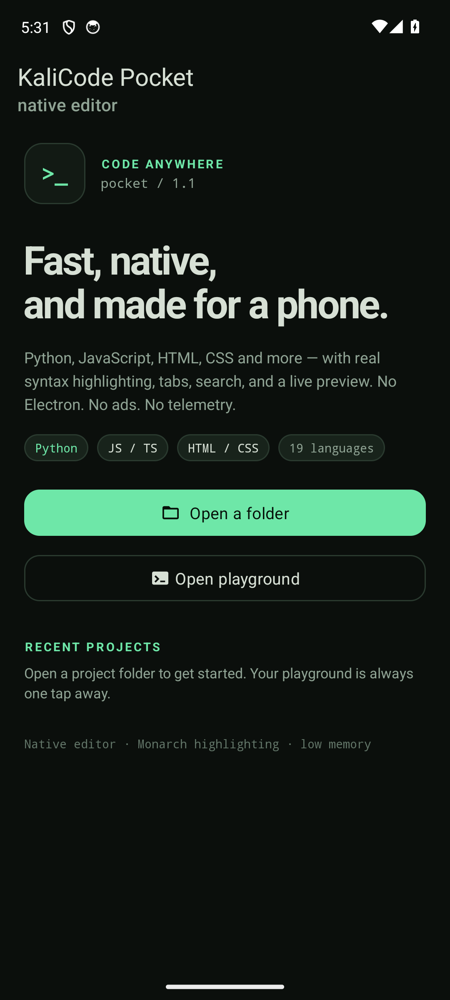
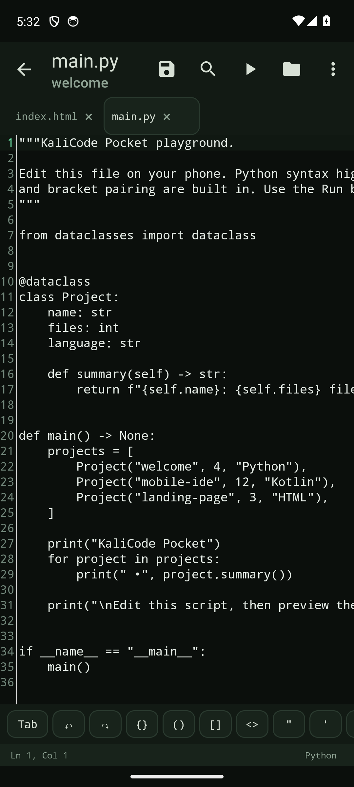
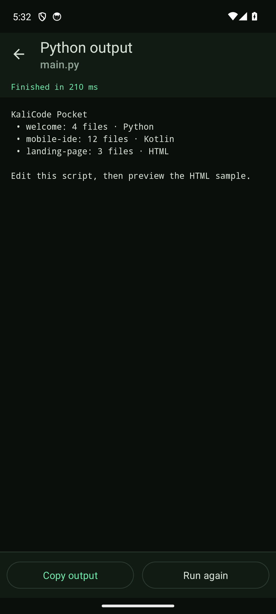

# KaliCode Pocket

**A fast, native Android code editor built for phones.** No Electron, no WebView-based editing, no ads, and no telemetry.

KaliCode Pocket uses **Kotlin + Android XML Views** with **Sora Editor** and **Monarch** grammars. The editor itself is fully native; a WebView is used only for the optional HTML/CSS/JavaScript preview.

[](LICENSE)
[](../../releases/latest)




## Highlights

- **Native code editor** — Sora Editor with Monarch tokenization, line numbers, bracket pairing, undo/redo, word wrap, adjustable font size, and syntax highlighting for 19 languages.
- **Embedded Python 3.12** — run Python files directly on the phone, with no Termux or external runtime. Stdout, stderr, and tracebacks appear in a native output screen.
- **Interactive `input()`** — each Python `input()` opens a native dialog, so beginner programs work on-device.
- **Project integration** — sibling `.py` imports, relative file access, `sys.argv`, and `if __name__ == "__main__":` work from the opened project.
- **Lightweight tabs** — up to 8 open files in one editor instance.
- **Find and replace** — match counts, next/previous, replace, and replace-all.
- **Phone-friendly input** — built-in symbol row for `{}`, `()`, `[]`, `<>`, quotes, `=`, and Tab; no hunting through keyboard pages.
- **Storage Access Framework** — open real folders through Android's picker, with a writable project copy for Python.
- **Playground included** — a ready-to-run sample project for Python, HTML, CSS, and JavaScript.
- **Live preview** — HTML/CSS/JavaScript preview with relative asset loading and a captured JavaScript console.
- **Two themes** — dark **Kali** and light **Paper**, with high-contrast syntax colors.
- **Auto-save and manual save**, recent projects, and a clean file browser with create, rename, and delete.
- **No `INTERNET` permission.** No ads, analytics, or telemetry.

## Languages

Python, JavaScript, TypeScript, HTML, CSS, JSON, Markdown, Java, Kotlin, XML, YAML, Shell, SQL, C/C++, Go, Rust, PHP, Ruby, and Lua.

## Screenshots

| Editor | Python output |
| --- | --- |
|  |  |

## Install

### Download the APK

Download `KaliCodePocket-1.1.1-release.apk` from [Releases](../../releases/latest).

The release APK supports **arm64-v8a** phones and **x86_64** emulators and is about **41 MB**. It is signed with the developer's private release keystore. The keystore stays out of the repository (see [Release signing](#release-signing)).

### Install over USB

1. Enable **Developer options → USB debugging** on the phone.
2. Connect the phone by USB and approve the debugging prompt.
3. From this project directory:

```bash
adb devices
adb install -r dist/KaliCodePocket-1.1.1-release.apk
```

The debug build uses a separate package ID and can be installed side by side:

```bash
adb install -r dist/KaliCodePocket-1.1.1-debug.apk
```

- Release package: `com.saikishore.kalicodepocket`
- Debug package: `com.saikishore.kalicodepocket.debug`

## Using the app

- Tap **Open playground** to explore the bundled sample project.
- Open a `.py` file and tap **Run** to execute it on-device.
- Tap **Open a folder** to grant access to a project folder through Android's folder picker. Android does not allow selecting the storage root or the top-level `Download` folder; create or select a subfolder such as `Download/KaliCodeTest`.
- Use **FILES** to create files and folders. Long-press a file to rename or delete it.
- Use **Find** for search and replace.
- Use **Preview** on an HTML file for a local preview. Use **Preview** on a CSS file to preview it with a sibling `index.html`. Use **Preview** on a JavaScript file to open the JavaScript console.
- Open **Settings** to switch themes and adjust font size, wrapping, line numbers, auto-save, and tab size.
- Python's **Enter** key starts a clean new line without automatic indentation. Use the **Tab** button or spaces for Python blocks.

## Python support

Python runs **inside the app** using an embedded CPython 3.12 runtime provided by [Chaquopy](https://chaquo.com/chaquopy/). The Run button executes the current file and shows stdout, stderr, and tracebacks in a scrollable output screen.

Supported out of the box:

- Python 3.12 standard library.
- Sibling `.py` files and normal imports inside the opened project.
- File reads and writes relative to the script, using a writable copy of the project in the app cache.
- Top-level `if __name__ == "__main__":` code.
- `sys.argv[0]` set to the script name.
- Interactive `input()` calls, which open a native input dialog for each line.
- Up to 500,000 characters of captured output.

Current limits:

- Third-party packages installed with `pip` are not supported. Pure-Python modules placed in the project work.
- Modules that depend on desktop or native libraries — for example **pyttsx3**, `tkinter`, or `pygame` — are not supported.
- Output is captured and displayed after the program finishes; it is not streamed line by line.
- Infinite loops cannot be interrupted from the output screen yet. Leave the screen and force-stop the app if needed.
- Files written by Python go to the app's cache copy, not back into the SAF project.
- The project copy is limited to 400 text files and 25 MB.

## Requirements

- Android 8.0 (API 26) or newer.
- A device or emulator with USB debugging enabled for sideloading.

## Build from source

Requirements:

- JDK 17
- Android SDK with platform 34 and build-tools 34.0.0
- Host `python3` for the Chaquopy build step
- `local.properties` containing `sdk.dir=/path/to/Android/Sdk`

```bash
./gradlew :app:assembleDebug
./gradlew :app:assembleRelease
```

The debug APK is written to `app/build/outputs/apk/debug/app-debug.apk`. The first build downloads the CPython runtime and takes longer; later builds are incremental.

The release build is minified and resource-shrunk. An unsigned release APK is written to `app/build/outputs/apk/release/app-release-unsigned.apk`.

## Release signing

The APK published on GitHub and submitted to app stores is signed with a private,
self-managed RSA 4096 release keystore. The keystore and its passwords are kept
outside the repository.

Signing certificate SHA-256:

```text
CB:8B:54:2C:9A:F6:17:2F:87:0C:62:53:CB:65:C8:98:74:06:A0:76:20:E4:E1:12:F5:FA:D7:7C:7B:6C:EA:68
```

If you build and distribute your own copy, generate a private keystore and sign the release APK with it:

```bash
keytool -genkeypair -v -keystore keystore/kalicodepocket-release.jks \
  -alias kalicodepocket -keyalg RSA -keysize 4096 -validity 10000

~/Android/Sdk/build-tools/34.0.0/zipalign -f 4 \
  app/build/outputs/apk/release/app-release-unsigned.apk \
  dist/KaliCodePocket-release-aligned.apk

~/Android/Sdk/build-tools/34.0.0/apksigner sign \
  --ks keystore/kalicodepocket-release.jks \
  --out dist/KaliCodePocket-1.1.1-release.apk \
  dist/KaliCodePocket-release-aligned.apk
```

Keep the keystore and passwords backed up and private. They are required for every future update to the same app package — losing them means the APK can no longer be updated in place.

## Limits and notes

- Editable text files are limited to 4 MB; preview assets are limited to 12 MB.
- At most 8 files can be open in tabs at once.
- Preview assets are loaded locally. The preview does not have network access.
- JavaScript console output is captured from `console.log/info/warn/error` and uncaught errors.
- SAF behavior is controlled by the Android document provider; some folders are intentionally blocked by Android.
- Python 3.12 is built for both `arm64-v8a` and `x86_64`. The universal APK includes both.

## Project layout

```text
app/src/main/java/com/saikishore/kalicodepocket/
  EditorActivity.kt        native editor, tabs, search, save, run routing
  PythonRunActivity.kt     Python output screen and input() bridge
  PreviewActivity.kt       HTML/CSS/JS preview
  data/                    SAF and playground workspaces, exporter, settings
  editor/EditorLanguages.kt Monarch setup and themes
app/src/main/python/       embedded Python runner
app/src/main/assets/       grammars, themes, sample project, licenses
dist/                      locally built APKs
```

## License

App code and UI are **MIT-licensed**. Copyright © 2026 Sai Kishore. See [LICENSE](LICENSE).

Third-party components have their own licenses. See [NOTICE](NOTICE) and the [licenses](licenses/) directory. In particular:

- **Sora Editor** — LGPL-2.1-or-later
- **Monarch language pack** — Apache-2.0
- **Chaquopy** — MIT
- **Python 3.12** — Python Software Foundation License

When distributing an APK that includes Sora Editor, keep the corresponding source code available and retain the LGPL notice and license text.
